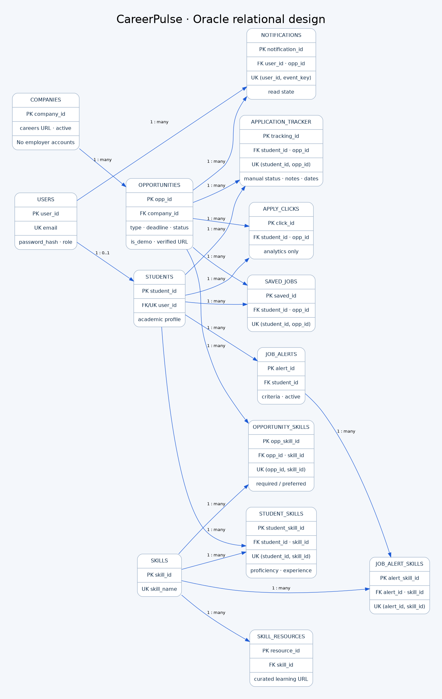

# Oracle database design

The app currently runs in explicit memory-backed demo mode. These Oracle 19c+
artifacts prepare the academic database milestone; they have NOT been executed
against Oracle. DATA_BACKEND=oracle deliberately fails until full adapter wiring
and live integration tests are completed. No SQLite fallback exists.

## Installation in a disposable course schema
1. Obtain a real Oracle database and an empty schema with CREATE TABLE/VIEW privileges.
2. Open SQL Developer (a client, not the database) and connect using your own credentials.
3. Run `db/schema.sql`, then `db/seed_data.sql`, then `db/views.sql` as scripts.
4. Supply bind variables and run the demonstrations in `db/queries.sql` and
   `db/transactions.sql`. DDL implicitly commits in Oracle. Never run these scripts
   blindly against an existing populated schema; no destructive reset script is provided.
5. Set ORACLE_USER, ORACLE_PASSWORD and ORACLE_DSN securely in `.env`, then run
   `python -m db.oracle_gateway` for a read-only connectivity check.

Seed data: one disabled admin, 15 disabled student accounts, 8 fictional companies,
25 opportunities, 12 skills, 60 student-skill rows, 30 saved jobs, 30 tracker rows,
8 alerts and 25 notifications. There are no usable seeded passwords. Provision
hashed credentials only when implementing live authentication. Explicit seed IDs
stay below 1000; generated identity IDs begin at 1000.

## Functional dependencies and normalization
A hypothetical unnormalized record contains a student, repeating skills, repeating
jobs, company names, tracker notes, and multiple alert skills in one row.

- **1NF:** split repeating skill/job/alert groups into rows; every stored attribute
  has a single value. Lists in the Python view models represent joins, not SQL columns.
- **2NF:** separate facts dependent on only part of a composite key. Skill name
  belongs to SKILLS, student profile to STUDENTS, and job facts to OPPORTUNITIES.
  STUDENT_SKILLS proficiency depends on the complete (student_id, skill_id) pair.
- **3NF:** remove transitive dependencies. opp_id determines company_id, which
  determines company_name and careers URL, so company data belongs to COMPANIES.
  student_id determines user_id; account name/email/hash/role belong to USERS.
- **BCNF:** under the stated dependencies, every determinant in each relation is a
  candidate key: user_id/email, student_id/user_id, skill_id/skill_name, and the
  natural pairs in associative tables. Surrogate IDs do not replace natural UNIQUE
  constraints. Company names need not be unique; companies may share a name.

The surrogate IDs and natural UNIQUE pairs preserve both record addressing and
business uniqueness. Junctions implement many-to-many relationships without
comma-separated IDs. Foreign keys prevent orphaned references. Soft-removing roles
and deactivating companies preserves student history. Referenced company deletion
is refused by both application logic and foreign keys.

## Intentional corrections and constraints
Required-skill matching uses distinct required skills only; preferred skills never
enter the denominator. Zero requirements returns SQL NULL / UI “Not scored”. A
student who knows Git cannot have Git in the missing list. Saved jobs and personal
tracker rows are independent; outbound click rows never update tracker status.

The brief’s NOT NULL apply_url is relaxed only to support fictional demo listings:
real listings must have an apply URL, and fictional listings cannot be verified.
Runtime validation checks HTTPS, credentials, and the company careers hostname.
Other additions include company active state, explicit demo/verified flags,
nonnegative salary/experience, CGPA 0–4, and unique notification event keys.

The application validates date-not-in-future rules; Oracle CHECK constraints cannot
reference SYSDATE. Deactivation and deadline filtering are reflected in the active
view. The student/role relation is additionally enforced by the future account
service, since a cross-table CHECK is not supported.

## Integration boundary and remaining live verification
`db/oracle_gateway.py` demonstrates parameterized matching reads, idempotent saved
writes, and an opportunity-plus-skills transaction with rollback. It is deliberately
not the application's full persistence adapter yet. Tests cover transaction rollback
and bound values using a test double, not Oracle execution. The remaining integration
must replace MemoryAccounts, DemoProfileStore, activity state and MockRepository
with scoped relational reads/writes while preserving their service contracts.

Live acceptance must validate DDL, seed counts, views, FK/UNIQUE/CHECK failures,
rollback after a failing skill insert, multi-user isolation, concurrent duplicate
saves, notification deduplication, matching parity and authenticated route behavior.
Until then, all real Oracle persistence is explicitly pending.

## Validation performed in this environment
SQLGlot's Oracle parser accepted 32 schema statements, 339 seed statements,
4 view statements and 11 query statements without unparsed-command fallbacks.
The PL/SQL block was reviewed manually. Three gateway unit tests check bind usage,
NULL score mapping, commit and rollback behavior. No SQL was executed on Oracle;
parser acceptance is not evidence that DDL, constraints or views execute correctly.
